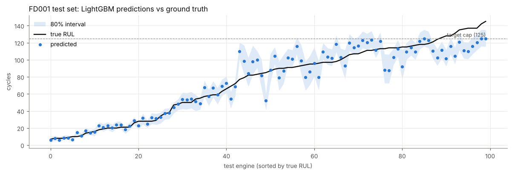
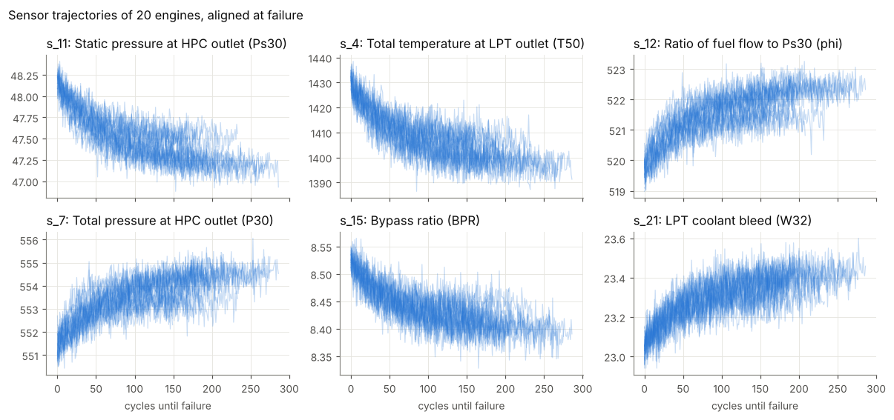
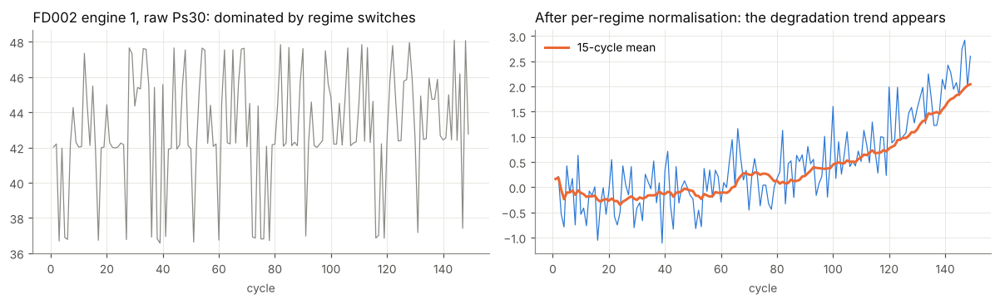

# TurboSensor

**Predictive maintenance for jet engines: estimating how many flight cycles a turbofan has left before it fails.**

TurboSensor is an end-to-end remaining-useful-life (RUL) system built on NASA's
[C-MAPSS turbofan degradation dataset](https://www.nasa.gov/intelligent-systems-division/discovery-and-systems-health/pcoe/pcoe-data-set-repository/).
It takes the raw history of 21 engine sensors and 3 operating settings, and gives back
a calibrated RUL estimate for each engine and a maintenance action (`replace`, `watch`, `ok`).
It can run as a batch job, a CLI, or a REST service.



## Results

All numbers are on NASA's held-out test engines, scored at each engine's last observed cycle.
LightGBM is the production model; ridge regression on the same features is the baseline.

| Subset | Conditions / faults | Test engines | RMSE (capped truth) | RMSE (raw truth) | NASA score (capped) | Missed failures @30 cycles | False alarms @30 (avg. cycles early) |
|---|---|---|---|---|---|---|---|
| FD001 | 1 / HPC | 100 | **10.85** | 12.15 | 166 | 0 of 25 | 3 (6.3) |
| FD002 | 6 / HPC | 259 | **9.95** | 22.65 | 432 | 0 of 61 | 13 (7.3) |
| FD003 | 1 / HPC + fan | 100 | **9.10** | 10.89 | 162 | 0 of 20 | 2 (3.0) |
| FD004 | 6 / HPC + fan | 248 | **10.75** | 23.66 | 569 | 0 of 53 | 16 (5.7) |

Ridge baseline on the same features, capped RMSE: 14.19 / 14.15 / 14.31 / 15.73. Full table: [`reports/metrics_summary.csv`](reports/metrics_summary.csv).

**How to read these numbers:**

- **Capped truth** is the protocol most published work uses. The true RUL is capped at 125 cycles, the same as the training target.
  **Raw truth** compares against NASA's RUL as given. The gap between the two comes from engines with more than 125
  cycles left. The model reports them as "healthy, at least 125", which is the intended behaviour. That's 22% of FD002's
  test engines and 27% of FD004's, which is why their raw RMSE is higher.
- **NASA score** is the asymmetric PHM08 metric. It penalises late predictions (the engine keeps flying past
  the point it should have been pulled) more steeply than early ones. Lower is better.
- **Missed failures / false alarms** come from the cost-based maintenance rule (see below). On all four test sets it
  caught every engine that failed within 30 cycles. Its false alarms are engines pulled a few cycles early: on average
  3-7 cycles before the 30-cycle horizon, not engines with plenty of life left.
- Prediction intervals cover 74-78% of capped truths on FD002, FD003 and FD004, against an 80% target.
  On FD001's 100 test engines, coverage is 67%.
- **Nothing was tuned on the test sets.** Every choice (windows, model settings, ensemble, alert threshold) was made on
  engine-grouped cross-validation over the training engines. The test sets were only scored at the end.

### The maintenance rule minimises cost, not just error

The planner asks one question per engine: will it fail within the next 30 cycles? The two mistakes don't cost the same:

| Mistake | Cost used |
|---|---|
| Missed failure (fails inside the horizon with no alert) | 100 cycles of engine life (an unscheduled removal) |
| False alarm (pulled while it still has life) | the cycles thrown away, 1 per cycle pulled early |

At training time, the model picks the alert threshold that minimises this total cost on its out-of-fold predictions.
It does this for every horizon from 10 to 60 cycles, and stores the thresholds with the model. For a 30-cycle
horizon, the learned thresholds are 36.5-41 predicted cycles. The costs live in each `configs/*.yaml` (`miss_cost`,
`false_alarm_cost`), so an operator can set them to match their own economics.

### What improved, and how it was measured

| Step | FD001 CV RMSE | FD004 CV RMSE |
|---|---|---|
| First version: windows 5/15/30 | 9.15 | 10.89 |
| Add a 60-cycle window | 8.66 | 10.73 |
| Stronger regularisation (`min_child_samples=100`, `reg_lambda=10`) plus a 3-seed ensemble (final) | 8.65 | 10.76 |

Other settings tried, all on cross-validation: fewer or more leaves, a slower learning rate, heavier column subsampling,
and a deeper tree configuration. None did better than this setup across all four subsets. On the test sets, capped
RMSE moved from 11.22 / 10.48 / 9.48 / 10.69 to 10.85 / 9.95 / 9.10 / 10.75.

## Why it's built this way

| Design choice | Reason |
|---|---|
| **Piecewise-linear target, capped at 125** | Wear can't be seen for most of an engine's life (see the figure below). Asking a model to tell 250 from 200 cycles left on an engine with no wear means training it on noise. |
| **Per-regime sensor normalisation** | FD002/FD004 fly six operating regimes, which are found with k-means on the settings. Switching regimes moves the sensors far more than degradation does. |
| **Causal features only** | Rolling mean/std (5/15/30/60 cycles), 60-cycle trend slope, EWMA, and drift from the engine's own early-life baseline. A test checks that adding future cycles never changes past features, so the model can run on a live engine. |
| **Engine-grouped cross-validation** | No engine appears in both a training fold and a validation fold. A random row split would leak each engine's trajectory into validation. |
| **Seed ensemble** | Three LightGBM models with different seeds are averaged, which removes some of the variance that row and column subsampling add. |
| **Split-conformal intervals** | Each prediction's interval comes from out-of-fold residuals, binned by predicted RUL. Quantile boosting fell apart on the capped target, because so many labels sit exactly at 125. |
| **Cost-based alert threshold** | A missed failure costs far more than pulling an engine a few cycles early. The threshold that minimises total cost is learned on out-of-fold predictions. |




## Quick start

```bash
git clone https://github.com/nawalkhann/turbosensor.git && cd turbosensor
pip install -e ".[dev,serve,notebook]"

turbosensor download                              # NASA C-MAPSS into data/raw (~12 MB)
turbosensor train --config configs/fd001.yaml     # CV + fit + test, artifacts in artifacts/FD001/
make train-all                                    # all four subsets (about 6 minutes on a 4-core CPU)
```

**Batch scoring of a fleet**, with one row per engine sorted by urgency:

```bash
turbosensor predict --model artifacts/FD001/lgbm.joblib --input data/raw/test_FD001.txt --output plan.csv
```

```
 unit  cycle  rul_pred  rul_lower  rul_upper  alert_threshold  action
   34    203       6.0        3.6        8.9             38.5 replace
   81    213       6.1        3.8        9.1             38.5 replace
   ...
```

**REST API**:

```bash
turbosensor serve --model artifacts/FD001/lgbm.joblib --port 8000
curl -s localhost:8000/health
curl -s -X POST localhost:8000/predict -H 'content-type: application/json' -d '{
  "horizon": 30,
  "readings": [{"unit": 7, "cycle": 1, "settings": [0.0, 0.0, 100.0],
                "sensors": [518.67, 642.1, 1589.7, 1400.6, 14.62, 21.61, 554.36, 2388.06, 9046.19, 1.3,
                            47.47, 521.66, 2388.02, 8138.62, 8.4195, 0.03, 392, 2388, 100.0, 39.06, 23.419]}]
}'
```

**Docker**:

```bash
docker build -t turbosensor .
docker run -p 8000:8000 turbosensor
```

The image downloads the data and trains the FD001 model during the build, so the container serves right away.

## Project layout

```
src/turbosensor/
  data.py           download, parse, RUL labelling
  preprocessing.py  regime clustering, per-regime normalisation, flat-sensor removal
  features.py       causal rolling, trend, and baseline-drift features
  model.py          RULModel: pipeline, grouped CV, conformal intervals, save/load
  evaluation.py     RMSE, MAE, NASA PHM08 score, interval coverage, error by RUL band
  maintenance.py    RUL to replace/watch/ok decisions, alert precision/recall
  pipeline.py       config-driven train/evaluate run
  cli.py, api.py    command line and FastAPI service
configs/            one YAML per subset
notebooks/          exploration and results walkthrough (executed)
tests/              unit tests on synthetic fleets plus a real-data check
```

## Development

```bash
make test     # pytest
make lint     # ruff check + format check
make notebook # rebuild and execute the notebook (needs trained artifacts)
```

CI runs lint and tests on Python 3.10-3.12. It then downloads the real data, trains FD001, and fails if
the capped test RMSE goes above 12. It also builds the Docker image and smoke-tests the API.

## Data

The data comes from A. Saxena, K. Goebel, D. Simon, N. Eklund, *"Damage Propagation Modeling for Aircraft Engine
Run-to-Failure Simulation"*, PHM08, and is distributed by the NASA Ames Prognostics Center of Excellence.
The raw files aren't committed. `turbosensor download` fetches them from NASA's public data repository.

## License

MIT
